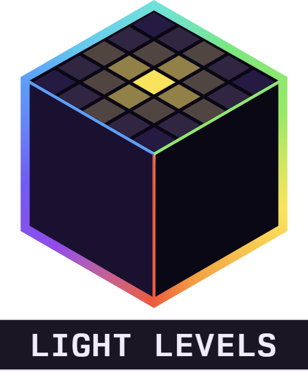

<div align="center">



# Alaydriem's Light Levels

[](https://github.com/alaydriem/levi-lightlevel/releases)
[](https://github.com/alaydriem/levi-lightlevel/actions/workflows/build.yml)
[](./LICENSE)

[](https://github.com/LiteLDev/LeviLamina)

</div>

A light-level overlay for Minecraft Bedrock. Shows the light level on every block near you where a mob can spawn, so you can find dark spots and light them.

Client-side only. It reads light data your game already has and sends nothing to the server.

## Usage

Press <kbd>Ctrl</kbd> + <kbd>L</kbd> to toggle the overlay. The key can be changed on the mod manager's Keybinds page.

Each spawnable block shows a number on its top face:

| Colour | Light |
| --- | --- |
| Red | 0 |
| Yellow | 1–7 |
| Green | 8–15 |

The number is the light above the block at the current time of day, so open ground reads 15 at noon and lower at night. Numbers update within a quarter second when you place or break a light.

The overlay hides with the HUD (<kbd>F1</kbd>) and starts off in each world.

## Installation

Requires the client build of [LeviLamina](https://github.com/LiteLDev/LeviLamina) and [Alaydriem's Mod Manager](https://github.com/alaydriem/levi-modmanager).

```powershell
lip install github.com/alaydriem/levi-levels#client
```

Or download the zip from the [latest release](https://github.com/alaydriem/levi-lightlevel/releases/latest) and extract it into `mods/`.

| Light Levels | Minecraft Bedrock | LeviLamina | Mod Manager |
| --- | --- | --- | --- |
| 0.1.0 | 1.26.51 | 26.51.6+ | 0.1.x |

## Configuration

Settings are in the mod manager panel and saved to `config.hcl` in the mod's config folder. Scan and memory settings apply after a restart.

| Setting | Default | Description |
| --- | --- | --- |
| `keys.toggle` | `"Ctrl+L"` | Toggle key |
| `scan.radius` | `24` | Radius in blocks (1–32) |
| `scan.pass_seconds` | `0.25` | Time for one full scan |
| `scan.max_labels` | `8192` | Max numbers drawn (nearest first) |
| `scan.max_columns_per_frame` | `512` | Max block columns read per frame |
| `light.red_max` | `0` | Highest light shown red |
| `light.yellow_max` | `7` | Highest light shown yellow |
| `label.red` / `label.yellow` / `label.green` | | RGBA colours, 0–1 |
| `label.lift` | `0.02` | Height above the block (0–0.05) |
| `label.scale` | `1.0` | Number size |
| `telemetry` | `false` | Log frame rate, cost and memory |
| `memory_budget_mb` | `32` | Memory budget |

## Building

Requires Windows x64, [mise](https://mise.jdx.dev), rustup, [cargo-nextest](https://nexte.st) and LLVM (`clang-cl`).

```powershell
mise trust
mise run preflight
mise run build-mod
mise run test
```

## License

BSD 3-Clause. Copyright (c) 2026 Charles R. Portwood II. See [LICENSE](./LICENSE).
